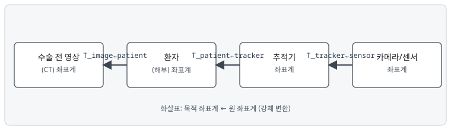

수술 전 영상을 지도처럼 두고, 광학 추적과 카메라, LiDAR, AI 글래스 같은 웨어러블 센서를 그 위에 올리려면 무엇이 필요할까. 이 글은 그 질문을 정리한 기록이다.

## 질문

지도는 수술 전에 얻은 3차원 영상이다. CT나 CBCT처럼 해부 구조를 담은 볼륨을 기준으로 삼는 경우를 말한다. 이후 관측의 위치는 이 영상을 기준으로 해석한다. 센서는 각각 다른 좌표계에서 위치와 자세, 또는 주변 구조를 관측한다. 광학 추적은 마커의 위치를 주고, 카메라와 LiDAR, 웨어러블 센서는 장면의 영상이나 거리 정보를 준다.

문제는 이 관측들을 같은 지도 위에 올리는 일이다. 좌표계를 맞춘다는 것은 각 센서의 관측을 지도 좌표로 변환하는 일이다. 한 센서만 영상에 맞추는 것으로는 부족하다. 서로 다른 센서의 관측을 하나의 좌표계로 묶어야 하고, 묶인 뒤에는 대상이 움직여도 그 관계가 유지되어야 한다. 변환이 정해져도 센서마다 오차의 성질과 갱신 주기는 다를 수 있다.

*그림. 수술 전 영상(CT), 환자(해부), 추적기, 카메라/센서 좌표계를 연결하는 변환 관계.*

## 일의 범위

나는 의료영상·수술 내비게이션 소프트웨어를 개발하는 R&D 연구원이다. 2023년 (AI 없이) DGIST에서 로봇공학 석사를 마쳤고, 지금은 4년 차다. 하는 일은 영상과 실제 공간을 맞추고, 광학 추적과 비전 센서를 하나의 좌표계로 연결하는 쪽에 가깝다.

영상 유도 시술에서 추적, 정합, 가시화, 소프트웨어는 서로 맞물린 구성 요소로 정리되어 있다[4]. 의료영상 정합은 영상의 차원, 정합의 근거, 변환의 종류 등으로 오래전부터 분류되어 온 문제다[1]. 수술 전 3차원 영상과 시술 중 2차원 투영 영상을 맞추는 방법도 따로 검토되어 있다[2]. 내가 해 온 일도 이 범위 안에 있다. 개별 과제나 협업의 결과는 이 글에서 다루지 않는다.

## 한 번 맞추고 끝나지 않는 이유

정합을 한 번의 맞춤으로 두면, 대상이 움직이거나 형태가 바뀔 때 지도와 센서의 관계가 어긋난다. 시술 중의 관측은 고정되어 있지 않다. 호흡이나 자세 변화, 조직의 변형이 있으면 처음에 구한 변환만으로는 부족하다. 처음 맞춘 변환을 끝까지 쓰는 방식은, 대상이 거의 움직이지 않는다는 가정이 있을 때만 성립한다.

점 기반의 강체 정합에서도 오차의 종류를 구분해 볼 필요가 있다. 맞춘 표지점 사이의 잔차(FRE)는 관심 위치의 오차(TRE)와 같지 않다. TRE는 표지점 수와 배치에 따라 달라지며, FRE가 작다고 해서 TRE가 작다고 보기 어렵다[3]. 강체 가정에서조차 이런 구분이 필요하다.

*그림. 표지점 근처의 FRE와 표지점 밖 관심 위치의 TRE는 같지 않다. (Fitzpatrick, West & Maurer, 1998[3])*

움직임과 변형까지 따라가려면, 정합은 한 번 구하고 끝내는 값이 아니라 계속 갱신해야 하는 문제가 된다.

## 보고 있는 방향

여러 센서를 같은 지도 위에 올리려면, 공간을 어떻게 표현할지와 여러 관측을 어떻게 한 추정으로 모을지를 같이 봐야 한다. 동시적 위치추정 및 지도작성(SLAM) 연구는 이동하는 관측자가 환경을 모형화하면서 자신의 상태를 추정하는 문제를 다룬다[5]. 이 리뷰는 센서 구성과 환경, 요구 정확도에 따라 난이도가 달라진다는 점도 분명히 한다.

여기서의 지도는 수술 전 영상이고, 관측은 추적 장치와 비전 센서다. 환경을 처음부터 그리는 문제와는 설정이 다르다. 그래도 공간을 어떻게 표현하고, 여러 관측을 한 추정으로 모을지에 대한 질문은 같다.

그래서 요즘은 3D Vision과 Spatial AI, Physical AI를 더 보고 있다. 이는 이미 확보한 전문성을 말하는 것이 아니다. 영상 지도와 다중 센서 정합이라는 질문을 따라가다 보니 그쪽으로 공부가 이어진다는 뜻이다.

## 앞으로 쓸 글

공부한 내용은 이 블로그에 남긴다. 다룰 내용은 아래와 같다.

- 의료영상과 실제 공간의 정합
- 여러 센서를 하나의 공간 지도 위에 올리는 문제
- 움직이는 3D 구조를 복원하고 추적하는 일
- 3D Vision·Spatial AI 논문 리뷰
- Physical AI 동향과 학습 기록

앞의 몇 편은 개념 정리에 두고, 논문 리뷰와 학습 메모는 그다음에 이어 간다. 각 글은 공개된 자료와 내가 이해한 범위를 구분해서 적는다. 확인하지 않은 수치나 내부 작업은 사실처럼 쓰지 않는다.

## 참고문헌

1. J. B. A. Maintz and M. A. Viergever, "A survey of medical image registration," *Medical Image Analysis*, vol. 2, no. 1, pp. 1–36, Mar. 1998, doi: [10.1016/S1361-8415(01)80026-8](https://doi.org/10.1016/S1361-8415(01)80026-8).
2. P. Markelj, D. Tomaževič, B. Likar, and F. Pernuš, "A review of 3D/2D registration methods for image-guided interventions," *Medical Image Analysis*, vol. 16, no. 3, pp. 642–661, Apr. 2012, doi: [10.1016/j.media.2010.03.005](https://doi.org/10.1016/j.media.2010.03.005).
3. J. M. Fitzpatrick, J. B. West, and C. R. Maurer, Jr., "Predicting error in rigid-body point-based registration," *IEEE Transactions on Medical Imaging*, vol. 17, no. 5, pp. 694–702, Oct. 1998, doi: [10.1109/42.736021](https://doi.org/10.1109/42.736021).
4. K. Cleary and T. M. Peters, "Image-guided interventions: technology review and clinical applications," *Annual Review of Biomedical Engineering*, vol. 12, pp. 119–142, 2010, doi: [10.1146/annurev-bioeng-070909-105249](https://doi.org/10.1146/annurev-bioeng-070909-105249).
5. C. Cadena, L. Carlone, H. Carrillo, Y. Latif, D. Scaramuzza, J. Neira, I. Reid, and J. J. Leonard, "Past, Present, and Future of Simultaneous Localization and Mapping: Toward the Robust-Perception Age," *IEEE Transactions on Robotics*, vol. 32, no. 6, pp. 1309–1332, Dec. 2016, doi: [10.1109/TRO.2016.2624754](https://doi.org/10.1109/TRO.2016.2624754).
